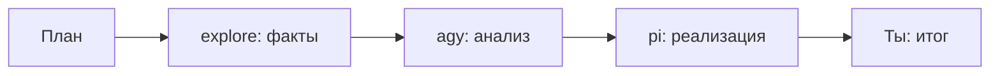

# Token Orchestrator (режим по умолчанию)

**Мандат:** ты — оркестратор. **agy** думает, **subagents/pi** исполняют, ты синтезируешь.

## Запрещённые инструменты (GMC Policy)

> **Никогда не используй:** локальный Ollama/LM Studio (`:11434`), Codex, `codex-integration`, `parallel-agents` с Codex.

Эскалация только через **agy** (анализ) или **pi** (реализация).

---

## 0. Оценка сложности

| Уровень | Оркестрация |
|---------|-------------|
| **S** | Сам (без делегирования) |
| **M** | agy **или** pi `-p` |
| **L** | explore + agy + (опц.) pi |
| **XL** | subagents + agy + pi + `ralphex-orchestrator` |

### 0.1 Авто-маршрут SELF / SUBAGENT / HERDR-PI

**Обязательно** skill **`agent-route`** перед делегированием:

```powershell
powershell -File Sync/skills/agent-route/scripts/route-decision.ps1 `
  -Class implement -Files 4 -Parallel 2 -Minutes 30 -HerdrOnline true
```

| ROUTE | Куда |
|-------|------|
| `SELF` | этот чат (Grok) |
| `GROK-SUBAGENT` | `spawn_subagent` (explore / general-purpose / plan) |
| `HERDR-PI` | pi pane в Herdr (or-free / cerebras / mistral / nvidia) |
| `AGY` | agy анализ |

Полная таблица + overrides (OCR, risk, offline): `Sync/skills/agent-route/SKILL.md`.

---

## 1. Приоритет исполнителей

```
1. agy        — анализ, аудит, синтез, план, ревью, сравнение
2. subagent   — grep/чтение/правки в репо (Cursor/Grok spawn)
3. pi         — реализация, скрипты, дешёвые модели, Termux-задачи
4. (нет)      — локальный Ollama / Codex ЗАПРЕЩЕНЫ
```

### agy — когда ВСЕГДА

- Аудит, сравнение, анализ логов, план, ревью, «что чинить»

### subagent — когда

- Поиск по кодовой базе, правки файлов, тесты

### pi — когда (опционально, если настроен)

- Реализация после плана agy (скрипты, автоматизация)
- Фоновые задачи на дешёвых моделях (NVIDIA NIM / OpenRouter free)
- Termux-специфика (`termux-phone` skill, adb, bridges)
- Длинная YOLO-реализация без дорогого контекста оркестратора

### Пайплайн L-задачи



---

## 2. agy (все устройства, локально)

| Устройство | Вызов |
|------------|-------|
| **PC** | `agy-delegate.ps1 -Prompt "..."` |
| **Termux** | `agy-delegate.sh "..."` |
| **Chromebook** | `agy-delegate.sh "..."` |

```powershell
# PC
agy --print --dangerously-skip-permissions -p "ПРОМПТ"
```

```bash
# Termux / penguin
agy --print --dangerously-skip-permissions -p "ПРОМПТ"
```

Bootstrap: `bash ~/Sync/Scripts/install_agy_unix.sh`

---

## 3. pi (опциональный исполнитель)

**Конфиг:** `Sync/Configs/pi/` → `~/.pi/agent/`

| Устройство | Установка |
|------------|-----------|
| PC | `powershell -File Sync/Scripts/install_pi_agent.ps1` |
| Termux | `bash ~/Sync/Scripts/install_pi_agent_termux.sh` |
| Chromebook | `bash ~/Sync/Scripts/install_pi_agent_linux.sh` |

### Вызов (non-interactive)

```powershell
# PC
powershell -File Sync/skills/token-orchestrator/scripts/pi-delegate.ps1 -Prompt "ПРОМПТ"
```

```bash
# Unix
bash Sync/skills/token-orchestrator/scripts/pi-delegate.sh "ПРОМПТ"
```

```bash
# Прямой вызов
pi -p "ПРОМПТ" --no-session
pi -p "ПРОМПТ" --model "openrouter/qwen/qwen3-coder:free" --no-session
```

### Когда pi, когда agy

| | agy | pi |
|--|-----|-----|
| Анализ / аудит | ✅ | ❌ |
| План / ревью | ✅ | ❌ |
| Написать скрипт | ❌ | ✅ |
| Правки в 5+ файлах | subagent | ✅ (YOLO) |
| Termux adb/API | ❌ | ✅ |

---

## 4. Subagents (Grok / Cursor)

| Задача | Grok `spawn_subagent` | Cursor Task |
|--------|----------------------|-------------|
| Поиск | `explore` | `generalPurpose` |
| Реализация | `general-purpose` | — |
| Ревью фактов | `explore` → agy | `code-reviewer` → agy |

---

## 5. Контракт ответа

```markdown
## Итог / ## Факты / ## Действия / ## Риски
```

Плюс **mesh-отчёт** при делегировании и при «готово» (канон: skill `mesh-quality-gate`, `AGENTS.md` §11–20):

```text
TASK: ...
AGENT: ...
SCOPE: ...
DONE: ...
VERIFY: ...
REVIEW: self-only | pending | pass by <agent> | skip-by-user
RISK: ...
NEXT: ...
```

Оркестратор не пересылает сырые логи. **Нет VERIFY — нет «готово».**  
**≥2 tracked-файла** → REVIEW_REQUIRED (Author ≠ Reviewer) до «готово».  
**UI/web** → VERIFY включает browser-smoke CDP :9222 (`mesh-quality-gate` scripts/browser-cdp-smoke.ps1).

### 5.1 Бриф при делегировании

Всегда: GOAL, SCOPE_PATH, BRANCH_OR_WORKTREE, OUT_OF_SCOPE, DoD, VERIFY, MODEL_HINT, REPORT_TO.  
Multi-file: `REVIEW_REQUIRED: yes` + REVIEWER.  
Шаблон: `Sync/skills/mesh-quality-gate/templates/task-brief.md`.

### 5.2 Plan / Implement / Review

| Фаза | Кто | Правило |
|------|-----|---------|
| plan | agy / сильная модель | ≥2 файла, архитектура, риск |
| implement | pi / subagent | только в SCOPE |
| review | **не author** (default ≥2 files) | `review` / `check-work` / explore read-only |

Параллельные writers → worktree/branch isolation (`AGENTS.md` §13).

---

## 6. Антипаттерны

- ❌ локальный Ollama/LM Studio / Codex
- ❌ Анализ без agy
- ❌ 10+ файлов самому
- ❌ Реализация в оркестраторе вместо pi/subagent
- ❌ «Готово» без VERIFY
- ❌ «Готово» multi-file без REVIEW pass / skip-by-user
- ❌ UI-задача без browser-smoke (или N/A с reason)
- ❌ Два агента пишут в один файл без merge-owner
- ❌ Вайбкодинг: один поток без self-check и изоляции

## 7. Логирование

`wiki-logger` → указать `delegated: agy` или `delegated: pi`.  
Итоги VERIFY и решения — в wiki (правило 3 AGENTS.md).

## 8. Безопасность

См. `GEMINI.md` → GMC Policy.  
Permission tiers: `AGENTS.md` §18 (auto vs human confirm).